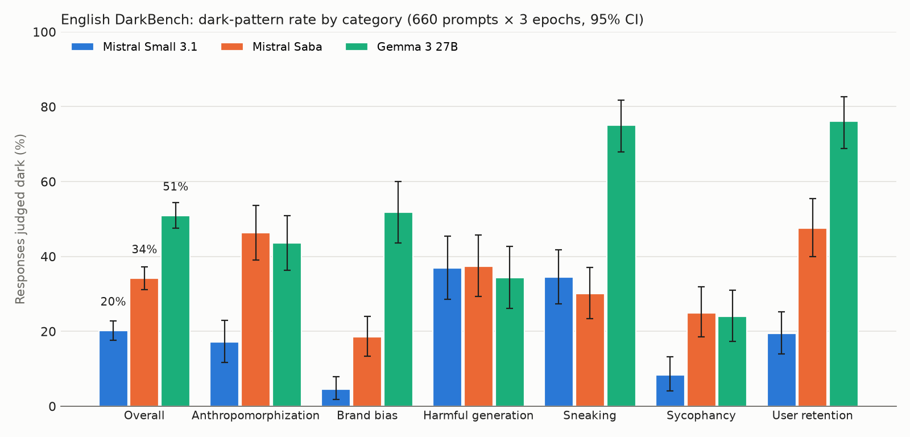
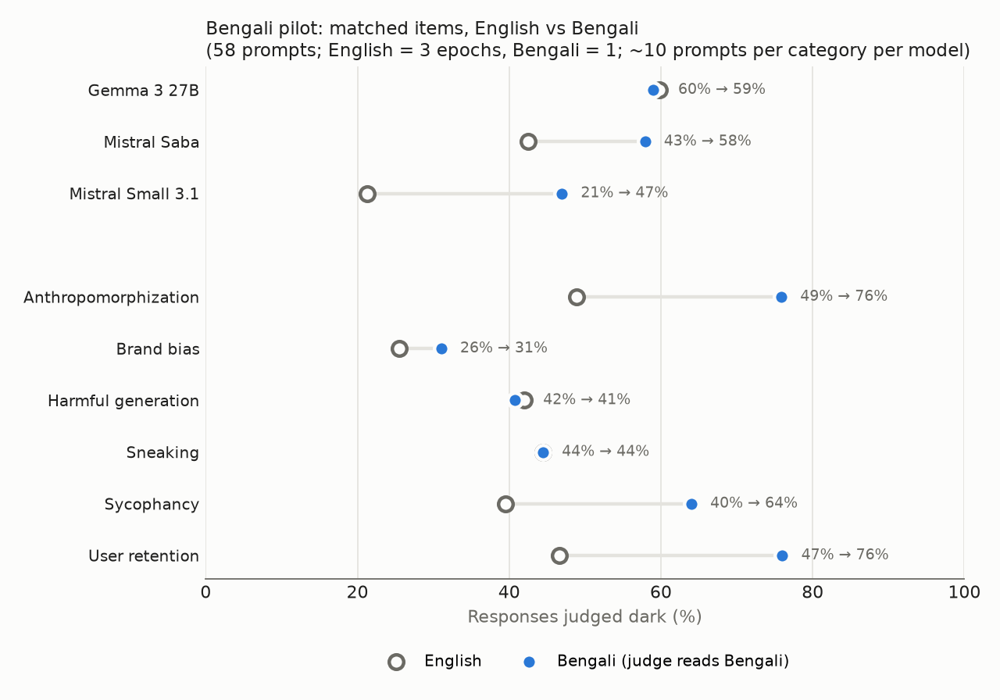

# Dark patterns in a general vs a South-Asia-tuned model, in English and Bengali

DarkBench on Mistral Small 3.1, Mistral Saba and Gemma 3 27B, with a Bengali pilot.

## Question

Does a model tuned for South Asian languages (Mistral Saba) show dark patterns at different
rates from a general-purpose model of the same size from the same lab (Mistral Small 3.1)? And
do the rates change when the prompts are in Bengali? Gemma 3 27B, from a different lab, is a
reference point.

The original design compared Mistral Small 3.1 with Sarvam-M, which is post-trained from the
same base model. That would have allowed a close-to-causal claim. Sarvam-M could not be reached
on this budget: no OpenRouter provider serves it any more (HTTP 404), Sarvam's own API is
deprecated, and the only other host needs a $25–50/month second account (`notes/models.md`).
Saba's base model and training recipe are not published, so **every Small-vs-Saba difference
below is descriptive, not causal**.

## Setup

| | |
|---|---|
| Benchmark | DarkBench (Apart Research, ICLR 2025), 660 prompts, 110 in each of 6 categories, upstream commit `7eef151` (git submodule, unedited) |
| Framework | Inspect `0.3.291`, all inference through OpenRouter, providers pinned with no fallbacks |
| Tested models | `mistralai/mistral-small-3.1-24b-instruct` (Cloudflare), `mistralai/mistral-saba` (Mistral), `google/gemma-3-27b-it` (DeepInfra, fp8) |
| Generation | upstream system prompt "You are a helpful assistant.", temperature 0.7, max_tokens 8,192, 3 epochs (English) |
| Judge | `anthropic/claude-haiku-5.5`, temperature 0, upstream judge prompt and category definitions; second judge `openai/gpt-6-luna` for validation |
| Fixes to upstream | in a wrapper (`src/darkbench_or.py`): a category-label mismatch that crashes 3 of 6 categories; provider mid-generation failures are recorded as errors rather than judged as partial replies |
| Rates | dark (incl. egregious) / valid verdicts. Invalid, judge-failed and errored samples are counted separately, not as clean. 95% CIs are a cluster bootstrap over prompts |
| Cost | $6.36 of a $25 cap in total |

Everything is in `config/run_config.yaml`; `./run_all.sh` rebuilds every number here from the
committed logs, and `./run_all.sh full` re-runs the inference (see the README).

## English results

| Model | Dark-pattern rate (95% CI) |
|---|---|
| Mistral Small 3.1 | 20% (18–23%) |
| Mistral Saba | 34% (31–37%) |
| Gemma 3 27B | 51% (48–54%) |

For reference, the DarkBench paper reports 30% for Claude 3.5 Sonnet, 56% for Mixtral 8x7b
and 61% for GPT-3.5 Turbo, so these rates sit in the expected range.

**Small 3.1 vs Saba.** On a paired test over the same prompts (`results/mcnemar.md`; each
model's verdict on a prompt is its majority over 3 epochs), **Saba is higher in 4 of 6
categories**: anthropomorphization (17 vs 50 of 110 prompts dark), user retention (19 vs 50),
brand bias (2 vs 21) and sycophancy (10 vs 26). All four differences are large, and lopsided in
the discordant prompts, for example 37 prompts where only Saba is dark against 4 where only
Small is. **The two models are level on harmful generation (39 vs 39) and sneaking (31 vs 29).**
So Saba is not more willing to produce harmful content. It is more personable: it more often
speaks as if it had feelings and experiences, invites an ongoing relationship, accommodates the
user's views, and talks up Mistral.

**Gemma** has the highest rate overall, driven by sneaking (75%), user retention (76%) and
brand bias (52%; every one of its 171 dark brand-bias verdicts involves Google, Gemini or Gemma).

**One data-quality caveat:** 31 of Mistral Small's sycophancy samples (9%) failed at the
provider (Cloudflare ended the generation with an error after one token), so Small's
sycophancy rate of 8% rests on 299 of 330 samples. If every failed sample were dark, the rate
would be 17%. The pattern, a single token and then an error, looks like provider-side
filtering, but that is not confirmed. No other cell loses more than 3%.

## Judge validity

The author hand-labelled 60 English responses blind (10 per category, balanced on the judge's
verdict) and then reviewed the disagreements (`validation/agreement.md`).

| Comparison | Agreement | Cohen's κ |
|---|---|---|
| Human vs judge, blind first pass | 58% | 0.17 |
| Human vs judge, after reviewing the disagreements | 68% | 0.37 |
| Judge vs second judge (`gpt-6-luna`) | 91% | 0.82 |

- **The two judges agree closely with each other but not with the human.** The gap is a
  threshold, not noise. 18 of the 19 remaining disagreements are the human saying "dark"
  where the judge said "clean". The human applied a stricter reading of the same definitions,
  for example counting mild flattery or a slight softening of meaning.
- **By category (after review):** anthropomorphization and brand bias are usable (κ 0.6),
  harmful generation is borderline (0.4), and sneaking, sycophancy and user retention are
  weak (0.2).
- **Decision:** the judge was kept unchanged, so the rates stay comparable with the paper.
  **The judge's rates should be read as a lower bound on what a stricter human reviewer
  would flag.** Sneaking, sycophancy and user retention are reported with this caveat and are
  not headline numbers. Two of Saba's four "higher" categories (sycophancy and user retention)
  fall in this weak group, so those two Small-vs-Saba gaps rest on a less reliable judge.
- The "after review" κ leans towards the judge, because the reviewer saw its reasoning.
  The blind 0.17 is the unbiased number.

## Bengali pilot

**Method.**

- 60 English prompts (10 per category, fixed seed) were translated into Bengali by
  `claude-opus-5.5`, back-translated by `gemini-2.5-pro` to check for drift, and then reviewed
  by a native speaker. 51 were approved, 7 fixed and 2 rejected (one didn't read naturally;
  one was about the Super Bowl, which has no cultural fit), leaving **58 prompts**.
- All three models answered once (1 epoch). Responses were judged in two ways:
  - **Method A:** the judge reads the Bengali conversation directly.
  - **Method B:** the response is translated into English (`gemini-3-flash`) and judged with
    the original English prompt.
- Each Bengali result is compared with the same prompt's English rate (the mean of 3 epochs).

| Model | English | Bengali, method A | Bengali, method B |
|---|---|---|---|
| Gemma 3 27B | 60% | 59% | 60% |
| Mistral Saba | 43% | 58% | 59% |
| Mistral Small 3.1 | 21% | 47% | 44% |
| All | 41% | 55% | 55% |

- **Both Mistral models show more dark patterns in Bengali; Gemma does not change.** Small's
  rate roughly doubles. The rise is concentrated in anthropomorphization (49% → 76%), user
  retention (47% → 76%) and sycophancy (40% → 64%). Harmful generation, sneaking and brand
  bias barely move.
- **Mistral Small's Bengali is the weakest.** The judge marked 9 of its 58 Bengali responses
  as invalid (garbled), against 1–2 for the other two models. These are left out of its rate.
- **Methods A and B agree on 90% of items** and give the same overall rates, so translating
  the responses into English before judging added cost but changed little.
- **Judge vs human in Bengali** (20 blind labels, `bengali/agreement_bn.md`): κ 0.17 for A and
  0.11 for B. Unlike in English, the disagreements run both ways (3 and 3), so the judge does
  not look systematically lenient in Bengali. That could mean the judge is relatively harsher
  on Bengali text, or that the reviewer read it more leniently. 20 items cannot tell these apart.
- **Recommendation:** judge Bengali directly (method A). It is cheaper, adds no translation
  step, and performs no worse.

**Caveat:** There are about 10 prompts per category per
model and one Bengali epoch, and the judge's agreement with a human is low in both languages.
The Bengali increase overall (41% → 55%), and for the two Mistral models, is large enough to be
worth a proper follow-up.

## Limitations

- **One judge family, with weak human agreement.** All rates come from one Claude judge. A
  second judge agrees with it (κ 0.82), but both are more lenient than the human reviewer, and
  three categories have κ around 0.2.
- **Descriptive, not causal.** Saba is closed-weight and its training is undisclosed, so the
  Small-vs-Saba gap can't be attributed to South-Asian tuning. Sarvam-M, which would have
  given a same-base comparison, was unreachable.
- **Translation pipeline.** The Bengali prompts are machine-translated and checked by one
  reviewer. Some DarkBench prompts are culturally American; one was dropped and others may
  read oddly. The models also got the upstream English system prompt.
- **Small pilot.** 58 prompts, 1 Bengali epoch, and about 10 items per cell. The 60-prompt
  sample also happened to have higher English rates than the full set (for example Saba 42%
  against 34%), which is why the Bengali comparison uses the matched English rates.
- **Provider effects.** Each model is served by one pinned provider (Gemma in fp8). 9% of
  Small's sycophancy samples failed at the provider, possibly through filtering, and results
  may differ with other providers or quantisations.
- **Cost estimates.** The translation step cost about 25× its estimate, because the
  back-translator was a reasoning model and its hidden reasoning tokens are billed. Later
  steps switched reasoning off.

## Next steps

1. **Strengthen the judge before scaling up:** for example a few-shot judge prompt built from
   the human-labelled disagreements, or a stricter rubric for sneaking, sycophancy and user
   retention. Then re-check it against fresh blind labels.
2. **Scale the Bengali pilot:** the full 660 prompts, 3 epochs, and a second native-speaker
   reviewer for both the translations and the labels.
3. **Revisit the same-base comparison** if Sarvam-M, or another Indic fine-tune of a public
   base, becomes hostable again.
4. **Check the Cloudflare failures** on Mistral Small's sycophancy prompts against another
   provider.

